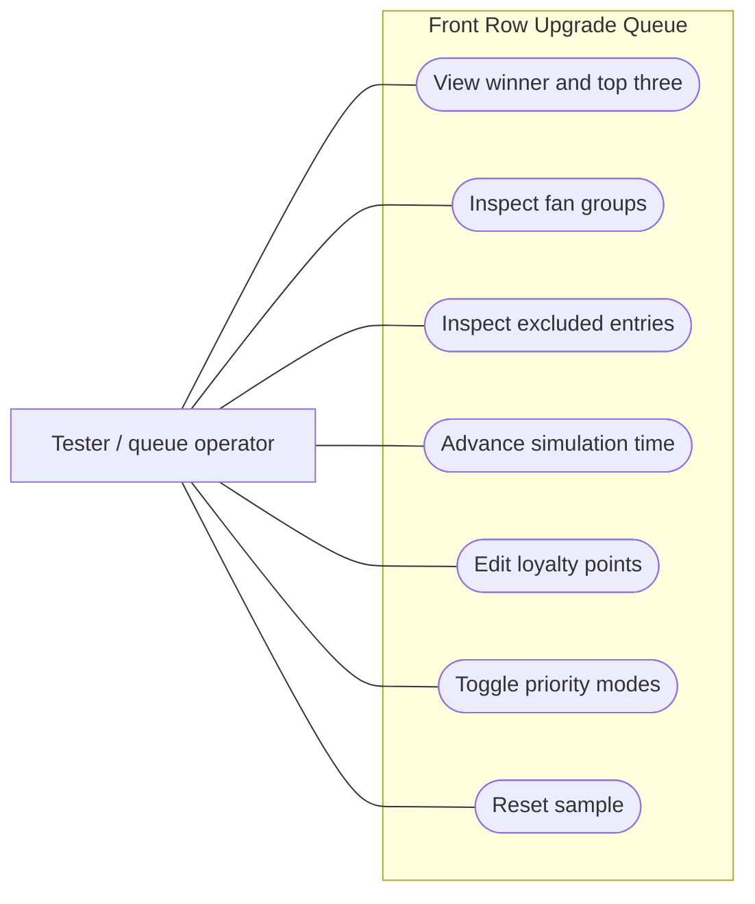
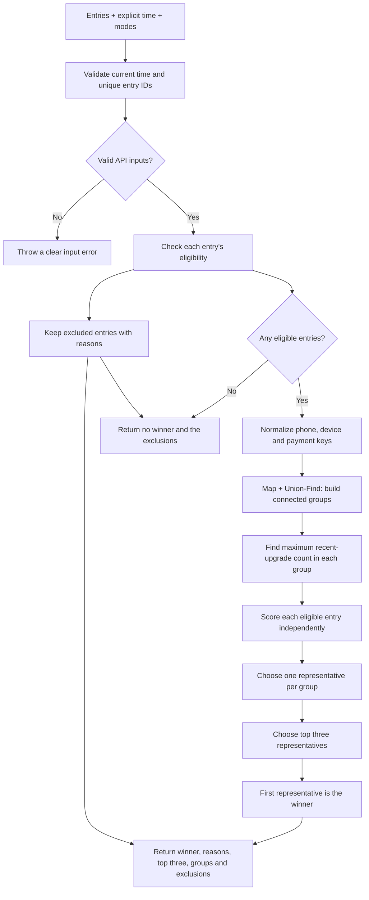
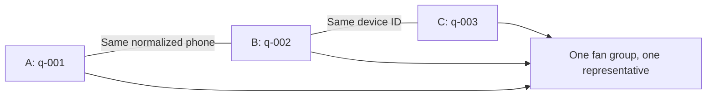

# Use cases and diagrams

This document describes the implemented simulator. The operator is a tester or queue administrator. Fans are queue data; the app does not include a fan registration or login screen. Data is held in React memory and resets on refresh. There is no backend, database or actual ticket issuance.

## Use cases

| ID | Operator action | Expected result |
| --- | --- | --- |
| UC-01 | Open the queue | Show the winner, score breakdown, selection rule and top three group representatives. |
| UC-02 | Inspect fan groups | Show members, representative and direct links proving indirect connectivity. |
| UC-03 | Inspect exclusions | Show ineligible entries and a clear reason for each. |
| UC-04 | Advance time by 5 min, 15 min or 1 hour | Recalculate waiting scores and exclude events at or past their start time. |
| UC-05 | Edit an entry's loyalty points | Recalculate that entry, its group representative, the top three and the winner. |
| UC-06 | Toggle priority modes | Apply the selected waiting, VIP and recent-upgrade weights and recalculate. |
| UC-07 | Reset | Restore sample entries, the initial simulation time and all default modes. |

## Use case overview

The following is a simplified capability map, expressed as a Mermaid flowchart rather than formal UML use-case notation.

## Selection flow

Both representative selection and global selection use: highest score, earliest exact queue join time, then smallest unique entry ID. A group's individual scores are never summed. Eligibility filtering precedes grouping; excluded accounts do not act as bridges.

## Indirect account connection

A and C do not need to share an identifier directly. All three are in one connected component. Empty identifiers do not create links.

## Example acceptance scenario

1. Open the sample: Maya wins with **174** points.
2. Change Riley's loyalty from 200 to 1,000: Riley wins with **242** points.
3. Advance by one hour: Riley's concert has started, so Riley appears under exclusions. Maya wins with **294** points.
4. Reset: Maya returns to **174** points, Riley's loyalty returns to 200, the initial time is restored and all modes are off.

## Implementation map

- `src/App.tsx`: queue, simulation time and mode state; recalculates derived results.
- `src/core/queue.ts`: pure eligibility, grouping, scoring and winner selection.
- `src/core/types.ts`: input/output contracts.
- `src/components/QueueControls.tsx`: time, modes and reset actions.
- `src/components/Results.tsx`: winner, score breakdown, top three and scoring rules.
- `src/components/QueueDetails.tsx`: fan groups, loyalty editors and exclusions.

Mermaid blocks can be previewed in an editor/viewer with Mermaid support. The source remains readable as Markdown in VS Code.
